<div align="center">

# 📱 Genius Store

**A full-stack e-commerce platform for smartphones, smartwatches, tablets and accessories.**

A customer storefront, an admin panel and a REST API, with Bakong KHQR payments, live chat and one-command Docker setup.


</div>

---

## 📸 Screenshots

| 🛍️ Storefront | 🛠️ Admin dashboard |
|---|---|
| 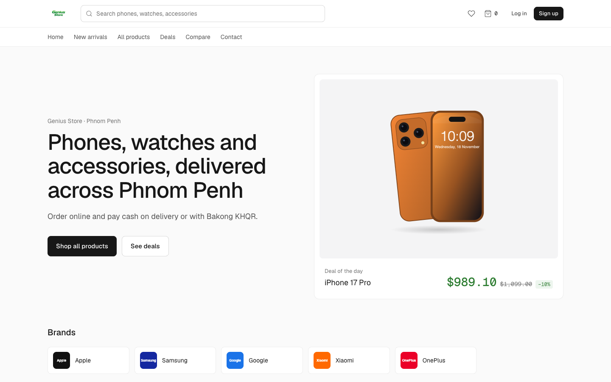 | 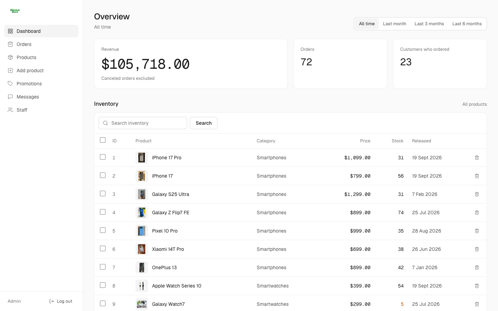 |

### 🛍️ Shopping flow

| **Product page**: pick storage and colour, live deal price | **Reviews**: rating summary, filters, helpful votes |
|---|---|
| 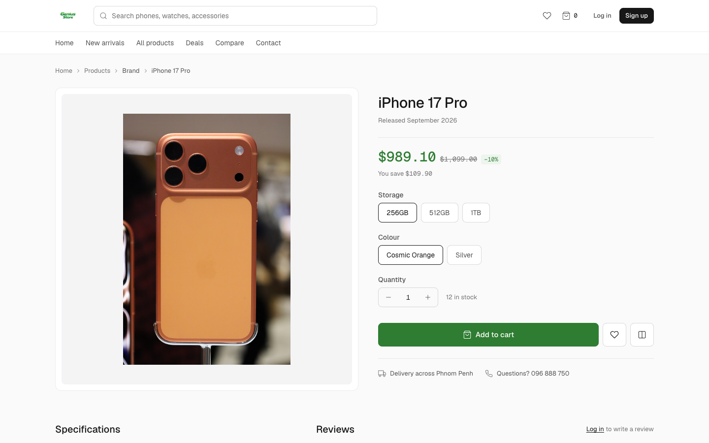 | 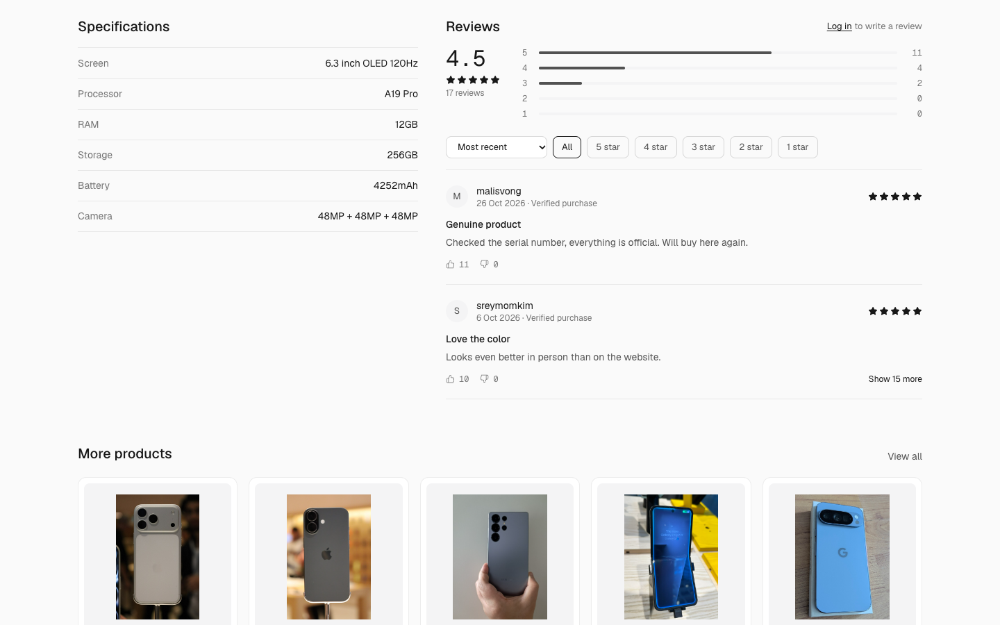 |
| **Compare**: up to 3 phones side by side, differences highlighted | **Checkout**: delivery or pickup, cash on delivery or Bakong KHQR |
| 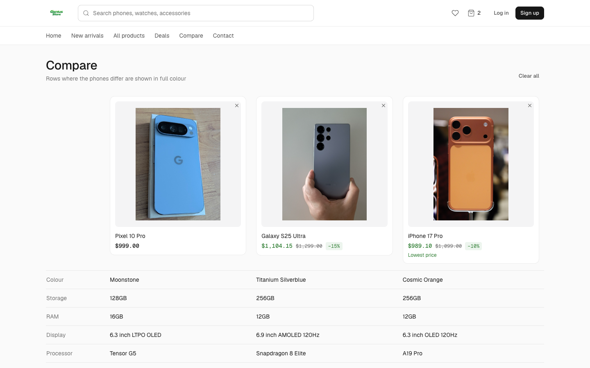 | 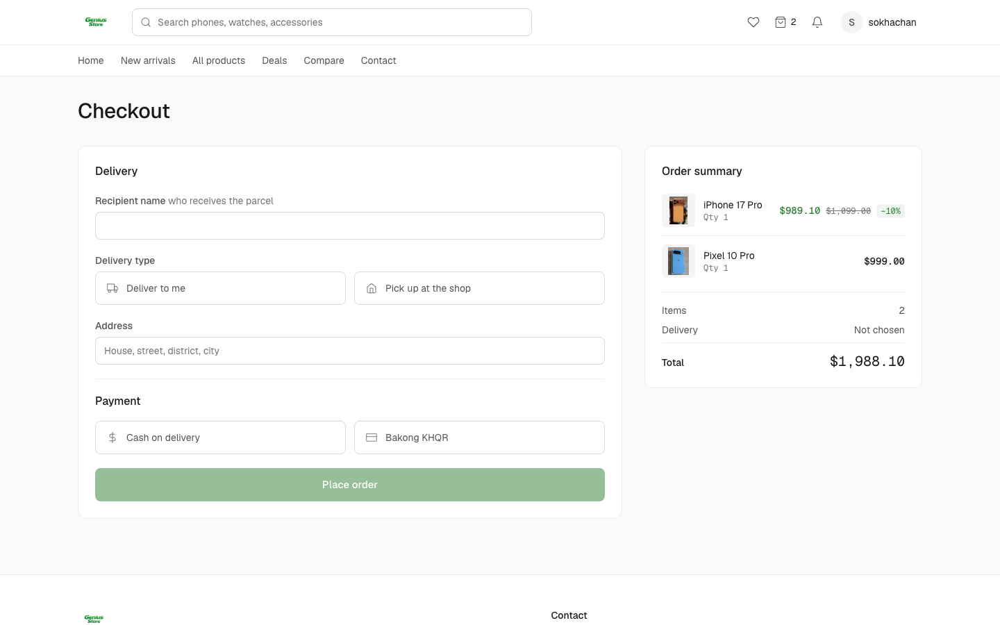 |
| **My orders**: order history with status and receipts | |
| 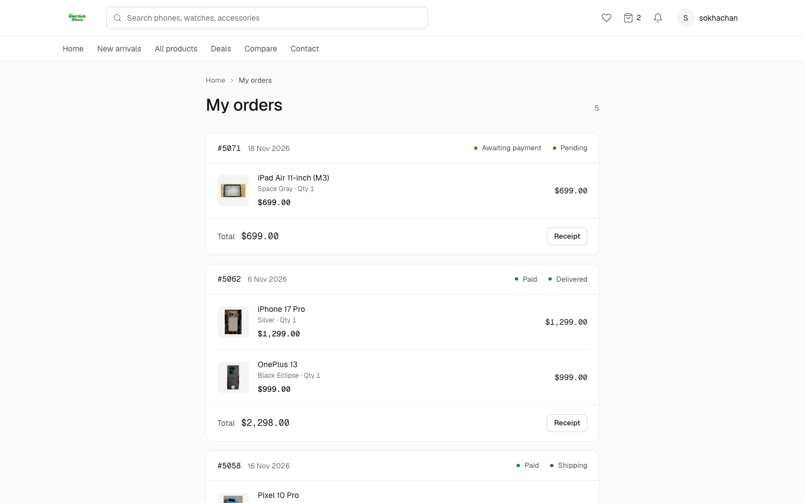 | |

### 🛠️ Running the store

| **Orders**: status counts, search, payment and delivery status | **Order detail**: items, payment check, customer and delivery |
|---|---|
| 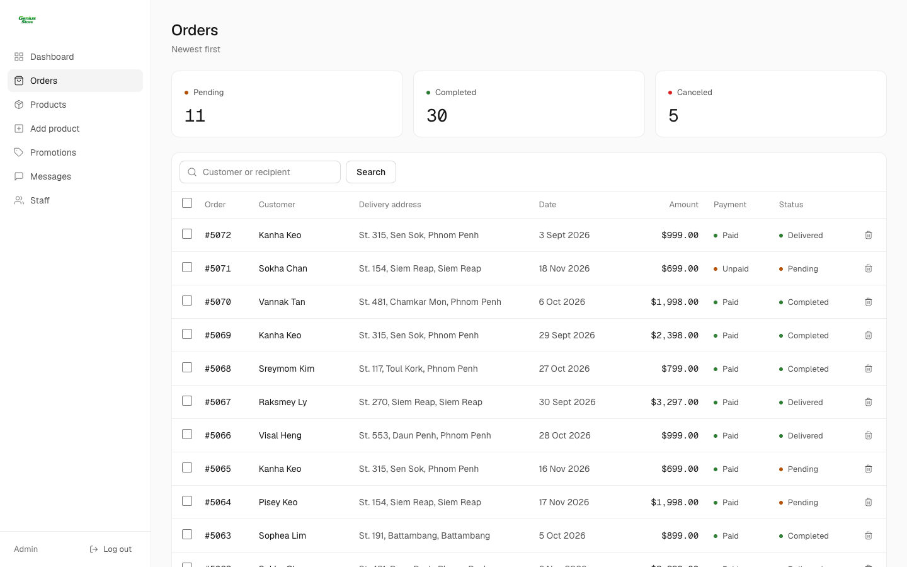 | 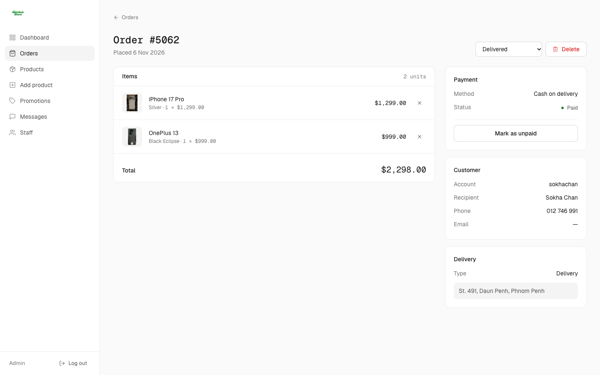 |
| **Promotions**: discount a product variant for a date range | |
| 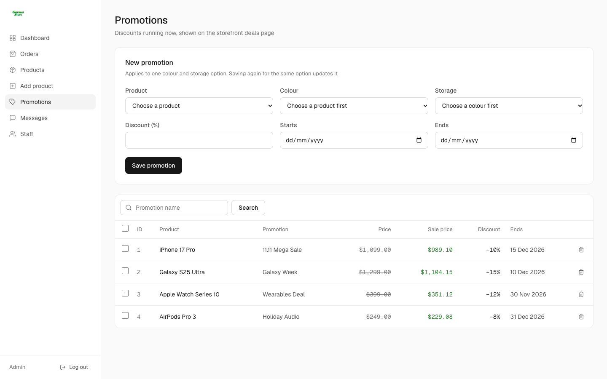 | |

<sub>Shown with demo data. Product photos from Wikimedia Commons, see Photo credits below.</sub>

## ✨ Features

<table>
<tr>
<td valign="top" width="50%">

### 🛍️ Storefront
- Browse by **category**, **brand**, **new arrivals** and **special offers**
- Search and sort by price, name or featured
- Pick **colour** and **storage** variants, with live discount prices
- **Cart**, **favourites** and **compare** up to 3 phones side by side
- Checkout with cash on delivery or **Bakong KHQR** QR payment
- Order history, receipts and order cancellation
- ⭐ Reviews with helpful / unhelpful voting
- 💬 Live chat with the store and notifications
- Profile, avatar upload and password change

</td>
<td valign="top" width="50%">

### 🛠️ Admin panel
- 📊 Dashboard: revenue, orders, customers by date range
- Manage **products**, **colour variants**, **specs**, **brands** and **categories**
- Order management with status tracking (pending → shipping → delivered / canceled)
- Payment confirmation
- 🏷️ Promotions with start and end dates, auto active / inactive
- Reply to customer chats
- Role-based access control (RBAC)

</td>
</tr>
</table>

## 🏗️ Architecture

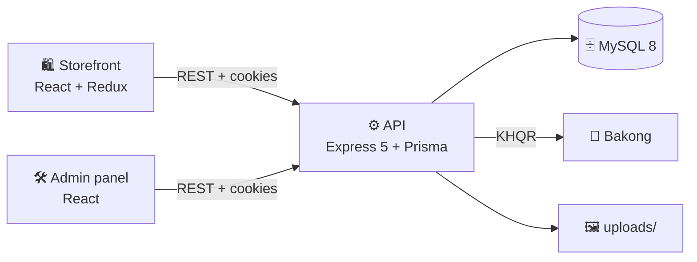

Auth uses **JWT access + refresh tokens in HTTP-only cookies**; expired access tokens are refreshed automatically.

## 🚀 Quick start (Docker)

```bash
cp .env.example .env   # then fill in the secrets
docker compose up --build
```

| Service | URL |
|---|---|
| 🛍️ Storefront | http://localhost:5173 |
| 🛠️ Admin panel | http://localhost:5174 |
| ⚙️ API | http://localhost:3000 |
| 🗄️ MySQL (for DB tools) | `localhost:3307` |

On first start, any `*.sql` dump in `./database` is imported into the empty database. Run `docker compose down -v` to re-import.

<details>
<summary><b>Run without Docker</b></summary>

Needs Node.js 18+ and MySQL 8. Create `API/.env` (see `docker-compose.yml` for the variable names), then:

```bash
cd API && npm install && npm run db:migrate && npm run dev
```

```bash
cd User-Section && npm install && npm run dev
```

```bash
cd Admin-Section && npm install && npm run dev
```

</details>

## 📁 Project structure

```
PhoneShop-website/
├── API/              Express 5 REST API
│   ├── Controllers/  admin, auth, common (public), user
│   ├── Routs/        route definitions
│   ├── prisma/       schema and migrations
│   └── Utils/        JWT, cookies, uploads
├── Admin-Section/    admin panel (React + Vite + Tailwind)
├── User-Section/     storefront (React + Redux Toolkit + Tailwind)
├── docker/           shared frontend Dockerfile (nginx)
├── docs/             project overview and development notes
└── docker-compose.yml
```

## 📚 Docs

- [Project overview](docs/PROJECT_OVERVIEW.md): features, API endpoints, auth flow
- [Development notes](docs/dev-notes/): feature write-ups and fixes made along the way

## 🖼️ Photo credits

The product photos and the Apple and Xiaomi logos in the screenshots come from [Wikimedia Commons](https://commons.wikimedia.org/). They are used under the licences below. Brand names and logos belong to their owners.

<details>
<summary>Show credits</summary>

| Photo | Author | Licence |
|---|---|---|
| [AirPods Pro 3 with case](https://commons.wikimedia.org/wiki/File:AirPods_Pro_3_with_case.jpg) | Auggie G | CC BY 3.0 |
| [Apple Watch Series 10](https://commons.wikimedia.org/wiki/File:Apple_Watch_Series_10.png) | KK IN HK | Public domain |
| [Samsung Galaxy Buds2 Pro (Graphite) (3)](https://commons.wikimedia.org/wiki/File:Samsung_Galaxy_Buds2_Pro_(Graphite)_(3).jpg) | Gannu03 | CC BY-SA 4.0 |
| [SAMSUNG EP-T4510 45W POWER ADAPER BLACK](https://commons.wikimedia.org/wiki/File:SAMSUNG_EP-T4510_45W_POWER_ADAPER_BLACK.jpg) | Dinkun Chen | CC BY-SA 4.0 |
| [Samsung Galaxy Flip7 FE](https://commons.wikimedia.org/wiki/File:Samsung_Galaxy_Flip7_FE.jpg) | Ssu | CC BY-SA 4.0 |
| [Samsung Galaxy Z Flip7 FE Its Look When Closed](https://commons.wikimedia.org/wiki/File:Samsung_Galaxy_Z_Flip7_FE_Its_Look_When_Closed.jpg) | X-SHLIED | CC BY 4.0 |
| [Galaxy Watch 7](https://commons.wikimedia.org/wiki/File:Galaxy_Watch_7.jpg) | Kyu3a | CC BY-SA 4.0 |
| [IPad Air 11-inch (M3)](https://commons.wikimedia.org/wiki/File:IPad_Air_11-inch_(M3).jpg) | 茅野ふたば | CC BY-SA 4.0 |
| [Black iPhone 17](https://commons.wikimedia.org/wiki/File:Black_iPhone_17.jpg) | Ahmad Ali Karim | CC0 |
| [Lavender iPhone 17](https://commons.wikimedia.org/wiki/File:Lavender_iPhone_17.jpg) | Ahmad Ali Karim | CC0 |
| [Mist Blue iPhone 17](https://commons.wikimedia.org/wiki/File:Mist_Blue_iPhone_17.jpg) | Ahmad Ali Karim | CC0 |
| [White iPhone 17](https://commons.wikimedia.org/wiki/File:White_iPhone_17.jpg) | Ahmad Ali Karim | CC0 |
| [Cosmic Orange iPhone 17 Pro Max](https://commons.wikimedia.org/wiki/File:Cosmic_Orange_iPhone_17_Pro_Max.jpg) | Ahmad Ali Karim | CC0 |
| [Silver iPhone 17 Pro Max](https://commons.wikimedia.org/wiki/File:Silver_iPhone_17_Pro_Max.jpg) | Ahmad Ali Karim | CC0 |
| [Apple logo black](https://commons.wikimedia.org/wiki/File:Apple_logo_black.svg) | Original:  Rob Janoff | Public domain |
| [Xiaomi logo (2021-)](https://commons.wikimedia.org/wiki/File:Xiaomi_logo_(2021-).svg) | Xiaomi | Public domain |
| [OnePlus 13 back](https://commons.wikimedia.org/wiki/File:OnePlus_13_back.jpg) | Maksdroider | CC BY-SA 4.0 |
| [Arrière du Google Pixel 10 Pro pierre de lune de 256 Go](https://commons.wikimedia.org/wiki/File:Arri%C3%A8re_du_Google_Pixel_10_Pro_pierre_de_lune_de_256_Go.jpg) | Fabe56 | CC BY-SA 4.0 |
| [Pixel Buds Pro, orange](https://commons.wikimedia.org/wiki/File:Pixel_Buds_Pro,_orange.jpg) | Mliu92 | CC BY-SA 3.0 |
| [Google Pixel Watch - 1](https://commons.wikimedia.org/wiki/File:Google_Pixel_Watch_-_1.jpg) | KKPCW（Kyu3） | CC BY-SA 4.0 |
| [Samsung Galaxy S25 Ultra](https://commons.wikimedia.org/wiki/File:Samsung_Galaxy_S25_Ultra.jpg) | Jakub CA | CC BY 4.0 |
| [Samsung Galaxy S25 Ultra Titanium Silverblue](https://commons.wikimedia.org/wiki/File:Samsung_Galaxy_S25_Ultra_Titanium_Silverblue.jpg) | Alvis Jean | CC BY-SA 4.0 |
| [Galaxy Tab S10+ Back](https://commons.wikimedia.org/wiki/File:Galaxy_Tab_S10%2B_Back.jpg) | Nash Izumrud | CC BY-SA 4.0 |
| [Xiaomi 14T Pro](https://commons.wikimedia.org/wiki/File:Xiaomi_14T_Pro.jpg) | Petar Milošević | CC BY-SA 4.0 |

</details>

## 👥 Contributors

Built as a team project. See the [contributors graph](https://github.com/endsy2/PhoneShop-website/graphs/contributors).
