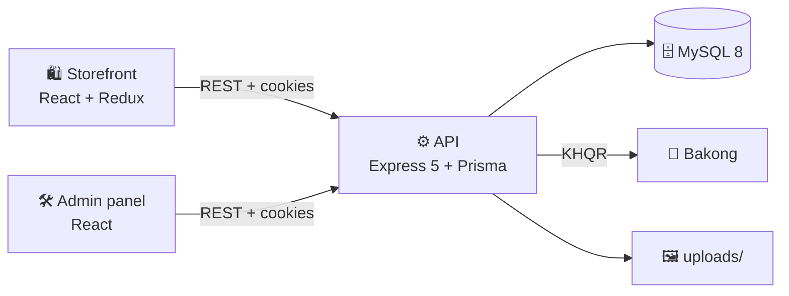

<div align="center">

# 📱 Genius Store

**A full-stack e-commerce platform for smartphones, smartwatches, tablets and accessories.**

A customer storefront, an admin panel and a REST API, with Bakong KHQR payments, live chat and one-command Docker setup.


</div>

---

## 📸 Screenshots

| 🛍️ Storefront | 🛠️ Admin dashboard |
|---|---|
|  |  |

<sub>Shown with demo data and generated product images.</sub>

## ✨ Features

<table>
<tr>
<td valign="top" width="50%">

### 🛍️ Storefront
- Browse by **category**, **brand**, **new arrivals** and **special offers**
- Search and sort by price, name or featured
- Pick **colour** and **storage** variants, with live discount prices
- **Cart**, **favourites** and **compare** up to 3 phones side by side
- Checkout with cash on delivery or **Bakong KHQR** QR payment
- Order history, receipts and order cancellation
- ⭐ Reviews with helpful / unhelpful voting
- 💬 Live chat with the store and notifications
- Profile, avatar upload and password change

</td>
<td valign="top" width="50%">

### 🛠️ Admin panel
- 📊 Dashboard: revenue, orders, customers by date range
- Manage **products**, **colour variants**, **specs**, **brands** and **categories**
- Order management with status tracking (pending → shipping → delivered / canceled)
- Payment confirmation
- 🏷️ Promotions with start and end dates, auto active / inactive
- Reply to customer chats
- Role-based access control (RBAC)

</td>
</tr>
</table>

## 🏗️ Architecture



Auth uses **JWT access + refresh tokens in HTTP-only cookies**; expired access tokens are refreshed automatically.

## 🚀 Quick start (Docker)

```bash
cp .env.example .env   # then fill in the secrets
docker compose up --build
```

| Service | URL |
|---|---|
| 🛍️ Storefront | http://localhost:5173 |
| 🛠️ Admin panel | http://localhost:5174 |
| ⚙️ API | http://localhost:3000 |
| 🗄️ MySQL (for DB tools) | `localhost:3307` |

On first start, any `*.sql` dump in `./database` is imported into the empty database. Run `docker compose down -v` to re-import.

<details>
<summary><b>Run without Docker</b></summary>

Needs Node.js 18+ and MySQL 8. Create `API/.env` (see `docker-compose.yml` for the variable names), then:

```bash
cd API && npm install && npm run db:migrate && npm run dev
```

```bash
cd User-Section && npm install && npm run dev
```

```bash
cd Admin-Section && npm install && npm run dev
```

</details>

## 📁 Project structure

```
PhoneShop-website/
├── API/              Express 5 REST API
│   ├── Controllers/  admin, auth, common (public), user
│   ├── Routs/        route definitions
│   ├── prisma/       schema and migrations
│   └── Utils/        JWT, cookies, uploads
├── Admin-Section/    admin panel (React + Vite + Tailwind)
├── User-Section/     storefront (React + Redux Toolkit + Tailwind)
├── docker/           shared frontend Dockerfile (nginx)
├── docs/             project overview and development notes
└── docker-compose.yml
```

## 📚 Docs

- [Project overview](docs/PROJECT_OVERVIEW.md): features, API endpoints, auth flow
- [Development notes](docs/dev-notes/): feature write-ups and fixes made along the way

## 👥 Contributors

Built as a team project. See the [contributors graph](https://github.com/endsy2/PhoneShop-website/graphs/contributors).
